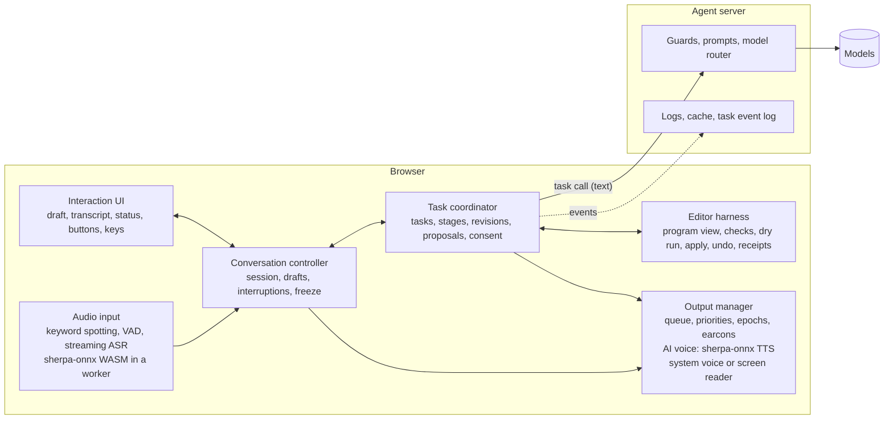
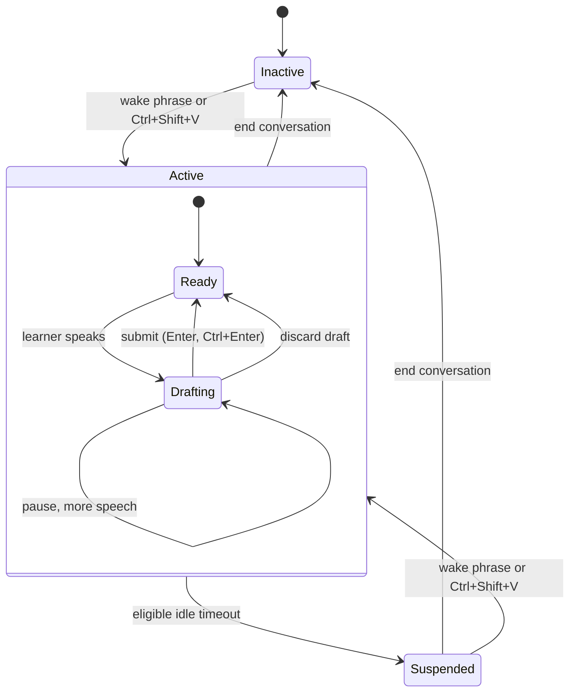
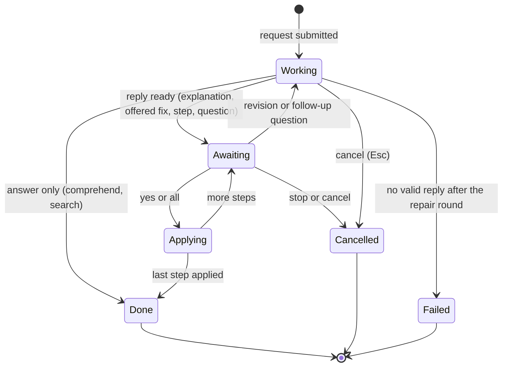
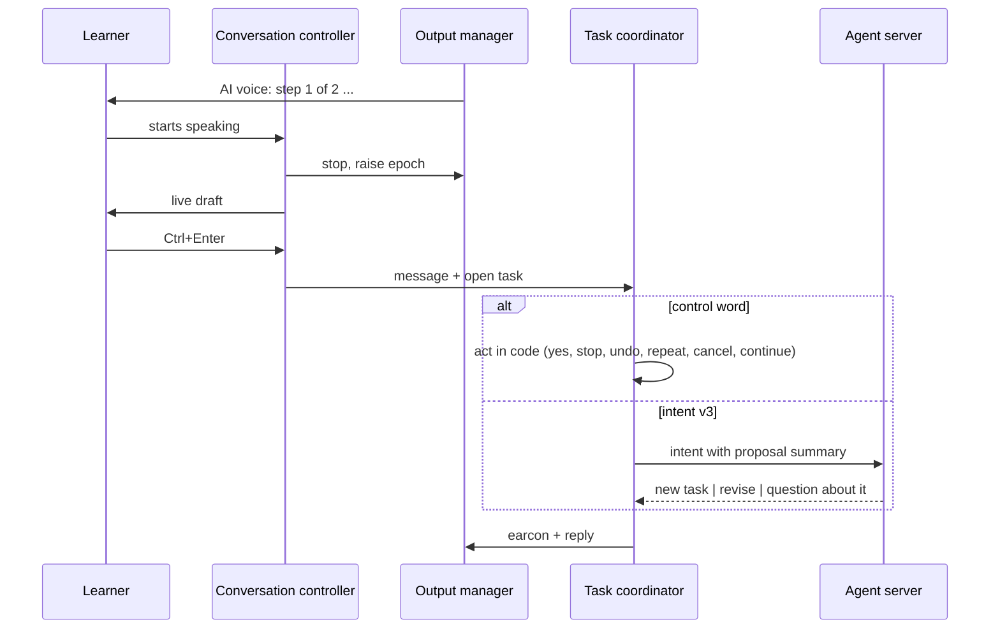

# Voice interaction design

Status: **agreed 2026-10-28, built** as `../specs/voice-interaction.md`. The "Today" column of section 3 describes the code before that build; the AI voice is Piper Kristin played by the page (spec decisions), not speech synthesis. Built on your draft (`intraction-design.md`, kept as is) and its three diagrams, revised to fit the browser and agent server split in `../ai-system-design.md`. The diagrams below (Mermaid) replace the PNGs where they differ; the PNGs still show the task coordinator in the backend and remote speech services.

## 1. Decisions *(decided 2026-10-28)*

- **The task coordinator is in the browser** (an extension of `src/interaction`). The agent server logs task events but decides nothing.
- **A spoken draft is submitted by a key:** Enter in the draft box, Ctrl+Enter (Cmd+Enter) from anywhere. A pause never submits.
- **Speech runs on the device:**
  - recognition: sherpa-onnx with a streaming Zipformer model in the browser (WASM); later compared with Whisper through Transformers.js; the browser's SpeechRecognition only as a fallback;
  - wake phrase: sherpa-onnx keyword spotting for "Hey Neon" (off until the learner turns it on), plus a shortcut that always works;
  - AI voice: the browser's speech synthesis with on-device voices only, for the first version *(changed 2026-10-28)*; sherpa-onnx Piper or a server voice can be added later behind the same interface.
- **Who speaks what:** every turn between the learner and the AI (spoken or typed) uses the AI voice, after a short earcon. During that turn the screen reader is not given the AI's text. Navigation and system speech use the screen reader (default) or the system voice, per the learner's setting.
- **Navigation freeze** (a learner setting, on by default): frozen while the AI works, speaks or applies a step; read-only while it waits for an answer. A blocked key gives short feedback, then the AI voice resumes. When on, mouse edits are blocked too.
- **Message meaning:** control words in code; everything else goes to intent v3, which also sees a summary of the open proposal.
- **Keys:** screen reader style (section 12). Voice barge-in is on, with safeguards, and I also stops the AI voice and starts listening.

## 2. Goals and principles

1. **The learner stays in control.** Nothing changes the program without a submitted yes. Speech can be cut off at any moment, by voice or key.
2. **Listening, speaking, working and navigating are separate states,** each with its own rules (section 4).
3. **Conversation control is local.** Stopping speech, starting a draft, freezing navigation, answering yes, undo: all in the browser, no round trip.
4. **Only what the learner submits leaves the device,** as text, through the agent server. Audio never leaves the device (except the fallback recognizer, section 13).
5. **Feedback is truthful.** Progress is spoken only for things that actually happened.
6. **One thing at a time for a blind learner.** The freeze keeps a learner from editing while the AI is mid-turn, which avoids accidental edits and overload.

## 3. Architecture

| Component | Where | Responsibility | Today |
|---|---|---|---|
| Audio input | browser, worker | Mic capture (echo cancellation on), wake phrase, voice activity, streaming transcripts | Web Speech in `pilot_voice.js` |
| Conversation controller | browser | Session state, drafts, interruptions, idle timers, navigation freeze, routing keys | spread over `blockly_pilot.js` |
| Task coordinator | browser | Task lifecycle, stages, revisions, proposals and consent, cancel | `src/interaction/assistant.js` (simpler) |
| Editor harness | browser | Program view, reply checks, dry run, apply, undo, receipts | `src/agent/`, `editor/plan.js` |
| Output manager | browser | One speech queue for AI voice, system voice and screen reader, earcons, epochs, priorities | not built |
| Interaction UI | browser | Draft box, transcript, status, chat buttons | Neon panel |
| Speech adapters | browser | Replaceable ASR, KWS, VAD and TTS engines behind one interface | none |
| Agent server | server | Guards, prompts, model calls, cache, logs, task event log | planned (`specs/agent-server.md`) |

## 4. State

Four independent state domains, plus the navigation lock that follows from them.

| Domain | Values |
|---|---|
| Session | inactive, active, suspended |
| Input | ready, capturing, draft |
| Output | silent, speaking (AI voice), announcing (system) |
| Task | none, working, awaiting answer, applying, done, cancelled, failed |
| Navigation lock (derived) | free, frozen, read-only |

### 4.1 Session

- A pause affects recognition only: it doesn't submit, clear the draft or end the session.
- A typed request needs no voice session; it starts a task directly. Its reply still uses the AI voice.
- Ending the voice session doesn't cancel a task; the learner hears if one is still open ("Your change is still waiting for a yes.").

### 4.2 Task

- **Awaiting** means the task waits for the learner: yes, all, stop, a clarification answer, or a revision.
- Undo is not a task state. It works on applied steps (receipts), one per request, even after a task ended.

### 4.3 Navigation lock

| Task and output | Lock (freeze setting on) | What a navigation key does |
|---|---|---|
| Working, or the AI voice speaking, or applying | frozen | Short system cue "The assistant is talking. Press Control to stop it." then the AI voice resumes |
| Awaiting an answer, AI silent | read-only | Moves and reads as usual; edits refused with a short cue. An edit by mouse is also refused |
| No task, or done, cancelled, failed | free | Normal |

With the setting off, navigation is always free; a changed program ends an offered step, as now.

## 5. Output: voices, earcons, queue

| What | Voice | Screen reader live region |
|---|---|---|
| AI turn (reply, question, progress from the AI) | earcon, then AI voice | not updated |
| Navigation, system messages, freeze cues | screen reader (default) or system voice | updated when the screen reader is the setting |
| Audio cues (connected, rejected, entered stack) | earcons | n/a |

- The chat log keeps every AI turn as text, readable by moving through it, but it is not a live region during AI turns, so nothing is read twice.
- **Queue priorities, highest first:** stop and freeze cues, questions to the learner, final outcomes and errors, progress. A new item of higher priority cuts a progress item; progress is dropped when its task finishes.
- **Epochs:** every AI turn has an `outputEpoch`. An interruption raises it; queued or late audio chunks from an older epoch are dropped.
- **Chunking:** text is split into sentences for TTS, so speech starts after the first sentence is synthesized and can stop between sentences.

## 6. Drafts and submission

- The draft shows final segments plus one replaceable partial segment, so revised partials never repeat words.
- The draft box is editable by typing; voice and keys can mix.
- Enter in the draft box or Ctrl+Enter anywhere submits. Esc in the draft box discards the draft.
- An empty draft does nothing on submit.
- Every submitted message is shown in the transcript and logged (masked on the server).

## 7. Interruptions

### 7.1 What happens at once

When the learner starts speaking (voice activity), taps Ctrl, or presses I while the AI voice speaks:

1. Stop the AI voice.
2. Raise `outputEpoch`; drop queued and late audio of that turn.
3. With voice or I: start a new draft (I also opens the mic if it was muted).
4. Keep the task as it is: an offered fix or step stays offered and is not approved by anything but a submitted yes.
5. Log the interruption (no server round trip needed to act on it).

A running model call is not cancelled by an interruption, only by cancel (Esc or "cancel"). Its result waits until the new message is understood.

### 7.2 What continues

| Work | During an interruption |
|---|---|
| AI voice | stops at once |
| A running model call | continues; its result may become obsolete |
| Reply checks and dry run | continue |
| Program changes | none happen without a submitted yes, so there is nothing to hold |
| A step already applied | stays; its receipt is kept; undo is a separate request |

Because applying happens only in direct answer to a submitted yes or all, and is instant and local, the race "a change landed just before the interruption" can't happen.

### 7.3 Voice barge-in safeguards

- Browser echo cancellation on the mic, and on-device VAD (sherpa-onnx, Silero VAD) with a short minimum speech length, so the AI's own voice and short noises don't count.
- A setting turns voice barge-in off (for learners on speakers whose AI voice keeps cutting itself off). Ctrl and I always work.
- **False interruption:** if no words arrive within about 2 s, the AI voice resumes from the start of the interrupted sentence.

### 7.4 After the message is submitted

## 8. What a submitted message means

**Control words, in code** (whole replies, as now, plus new ones; the full list is in `../task-coordinator-design.md` section 6):

| Words | Effect |
|---|---|
| yes, all, undo, repeat, go there | as today (`specs/assistant.md`) |
| stop talking, be quiet | silence the AI voice; the task stays |
| stop, no, cancel, never mind | end the task: abort a running call or withdraw the offered step; applied steps stay (undo is separate) |
| continue, go on | read the offered step again after checking it still fits the program |
| end conversation, goodbye | end the voice session; an open task is mentioned |

**Everything else goes to intent v3,** which gets the learner's words, the cursor and, when a task is open, a short summary of it ("Offered step 2 of 3: change the repeat count to 5"). It answers:

| Relation | Example | Effect |
|---|---|---|
| new task | "what does this block do" | the open proposal stays offered but the new task runs; debug or edit replaces it (as now) |
| revise | "actually, use the inner loop" | a new revision: the old proposal is withdrawn and the task reruns with the original request plus the correction |
| question about it | "why are you changing that?" | explained without changing the proposal, which stays offered |

**Consent is bound** to the proposal id, its revision and the workspace version. A yes can only approve the proposal the learner last heard, and only if the program is still the version it was checked against; otherwise the step is checked again (dry run) and offered again or withdrawn.

## 9. Task stages

The model returns a whole plan, but nothing is done until the coordinator moves through it with real results.

| Stage | What happens | Moves on when | Tasks |
|---|---|---|---|
| Understand | control word check, intent v3, scope from the cursor | an action is chosen | all |
| Clarify | ask one question | a submitted answer | when intent or edit asks |
| Generate | model call through the server | a reply arrives | all except search by code |
| Validate | id mapping, shape, dry run, speech checks; one repair round | the reply passes | all |
| Present | speak the explanation, the issue, or step N | spoken | all |
| Confirm | wait for yes, all or stop (every change, always) | a submitted answer bound to this proposal | debug fix, edit |
| Apply | apply the step on the live program | a receipt | debug fix, edit |
| Verify | run the program and compare (planned, needs the program runner) | a result | debug fix, edit |
| Report | say what was done ("Did step 2.") | spoken | debug fix, edit |

After a correction, the coordinator restarts from Generate with the new revision; steps already applied stay and are listed in the new request's context.

## 10. Identifiers

| Id | Purpose | Lives in |
|---|---|---|
| `sessionId` | voice and chat session | browser, sent to the server |
| `taskId` | one task | browser, logged |
| `revision` | the current version of the learner's request in that task | browser, logged |
| `proposalId` | an offered fix or plan; a yes binds to it | browser |
| `stepIndex` and `receiptId` | an applied step; undo takes back receipts newest first | browser |
| `workspaceVersion` | program state a proposal was checked against (hash of the serialized program) | browser |
| `outputEpoch` | the current AI turn's audio; older chunks are dropped | browser |
| `requestId` | one server call and its repair round | browser and server |

## 11. Progress from real events

| Event | Feedback |
|---|---|
| Message submitted | a short local "sent" earcon |
| Intent chose a model task | nothing if the reply comes within about 2 s; otherwise "Let me look at your program." |
| Model call still running | "I'm still working on it." after about 8 s, then at most every 10 s |
| Repair round started | "Checking my answer." (only if it runs longer than about 2 s) |
| Clarification needed | the question |
| Step applied | "Did step 2." with the next step |
| Verification done (planned) | the real result, e.g. "It now prints 5, 10, 15." |
| Failed | a short failure message |

- Progress is never invented: no "running tests" unless tests run.
- A progress line is dropped if the result is ready before it is spoken.
- Rapid events are merged; the queue never builds a backlog of progress.

## 12. Keys

| Key | When | Action |
|---|---|---|
| Ctrl+Shift+V | any time | start or end the voice session (exists) |
| Ctrl alone (tap) | AI voice speaking | stop the AI voice (screen reader habit) |
| I | AI voice speaking | stop it and start listening (push to talk) |
| Esc | task working | cancel the task |
| Esc | in the draft box | discard the draft |
| Enter | in the draft box | submit |
| Ctrl+Enter (Cmd+Enter) | anywhere in a session | submit the draft |
| Alt+Shift+Y, A, N, U, R | task awaiting an answer | yes, all, stop, undo, repeat |
| Shift+P | any time | open or close the panel (exists) |

- I and Esc keep their normal meaning (Insert, exit) whenever the AI voice is silent or no task is working.
- All keys are checked against `navigation_controller.js` and the pilot before building; Alt+Shift+Y, A, N, U, R and Ctrl+Enter are free today (Alt+letter is taken by the stack jumps, Alt+Shift+G by stack search).
- The chat buttons do the same as the Alt+Shift keys.

## 13. Speech engines and privacy

| Engine | Default | Later | Fallback |
|---|---|---|---|
| Recognition | sherpa-onnx streaming Zipformer, WASM | Whisper via Transformers.js (compare accuracy for children's speech, latency) | browser SpeechRecognition |
| Wake phrase | sherpa-onnx keyword spotter | | shortcut only |
| Voice activity | sherpa-onnx Silero VAD | | stop key only |
| AI voice | browser speechSynthesis, on-device voices (first version) | a clear, standard voice (changed 2026-10-28) | Piper (sherpa-onnx) or a server voice later |

- Engines run in a Web Worker, behind one adapter interface each, so they can be swapped.
- Models download once and are cached; the app says when voice is still loading.
- **The fallback recognizer sends audio to the browser vendor (Google in Chrome).** It is off by default and can only be turned on by the teacher, with a note in the teacher guide.
- The keyword spotter listens only while the session is inactive or suspended and the mic is allowed; a mic-off control stops all listening.

## 14. Idle and suspension

| Situation | Policy |
|---|---|
| No task, no draft | suspend after 60 s idle |
| AI working or speaking | not idle |
| Waiting for an answer or clarification | stop listening after 2 min; the question stays |
| Unsubmitted draft | keep the draft; stop listening after 5 min |
| "End conversation" or Ctrl+Shift+V | end now |

- The idle timer starts when the AI voice stops, not when the learner stopped talking.
- Before suspending: a short notice ("I'll stop listening now. Say Hey Neon when you need me.").
- On waking: the draft or open question comes back; an offered step is checked again against the program first.
- Suspended and microphone off are different: suspended still listens for the wake phrase.

## 15. Browser and server

The browser owns all of the above. The server sees:

- **Task calls** (`POST /v1/agent/call`): the submitted text and input parts, with `requestId`, `sessionId`, `taskId` and `revision`.
- **Events** (`POST /v1/agent/events`, sent in the background, batched; kinds and data in `../specs/agent-server.md` section 7): `session.started`, `session.suspended`, `session.ended`, `message.submitted`, `task.started`, `task.revised`, `task.stage`, `proposal.offered`, `step.applied`, `step.undone`, `task.cancelled`, `task.failed`, `speech.interrupted` (voice or key), `navigation.blocked`. Each has the ids from section 10 and a sequence number.

Events are for logs, research and teacher review (reliance signals). A page reload ends open tasks; restoring a session from the event log is a later step.

## 16. Effects on other parts

These need their own update after this design is agreed:

| Part | Change |
|---|---|
| Harness and prompts | intent v3 (relation to the open task, proposal summary in context); an "explain the proposal" path; revision requests carry the correction and applied steps |
| Context management | a short task summary (request, revision, offered proposal, applied steps) for intent and revisions; workspace version on every reply |
| Task coordinator | `assistant.js` grows into tasks with ids, revisions, stages, proposals and receipts |
| Output manager | new module: queue, priorities, epochs, earcons, AI voice and system routes; navigation speech moves through it |
| Navigation | the freeze and read-only lock through a hook, not by editing the stable files (needs a small approved hook, like `prepareConnect`) |
| Agent server | the event endpoint and tables; ids on task calls |
| Evaluation | intent v3 items with open tasks (revise, ask, new); latency to first speech; barge-in and false-interruption tests; recognition accuracy on children's speech |
| UI | draft box with partials, status (Listening, Working, Speaking, Waiting for you), settings for freeze, barge-in, output route, fallback recognizer |

## 17. Open questions

- The timings (2 s, 8 s, 60 s, 2 min, 5 min) are proposals; confirm or change.
- The earcon sounds (AI turn, sent, blocked) and the AI voice choice.
- Whether a sighted learner's default turns the freeze off.
- Device performance: sherpa-onnx WASM on school Chromebooks needs a test before the study.
- The navigation freeze needs a hook in the stable navigation code; approve where it goes.
